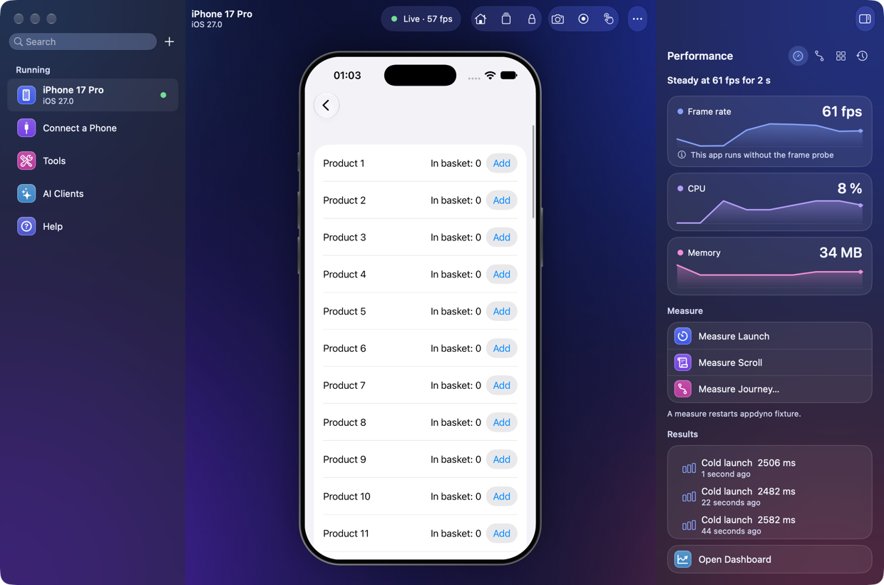
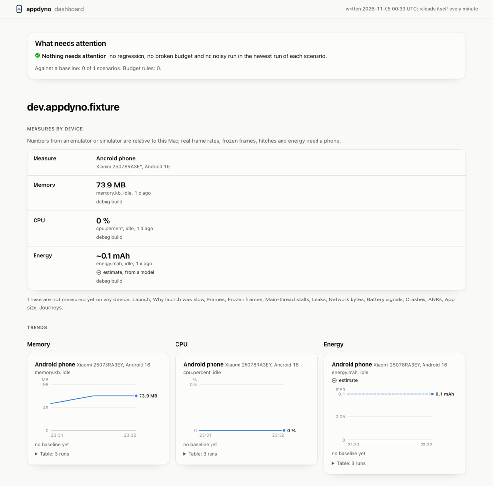

<p align="center">
  
</p>

# appdyno

**Let an AI agent test your mobile app.** appdyno is an MCP server, a command line and a Mac app that drives and measures iOS and Android apps on simulators, emulators and real phones.


A real run, not a mock-up: an MCP client makes the calls in the terminal, with their real times, while the hub shows the phone and reads it.

An agent can read the screen, tap, type, and check what happened. You can watch and touch the same device in a live window. The performance numbers come from the device itself: frames, memory, CPU and launch time. It all runs on your Mac, with no cloud and no telemetry.

Works with Claude Code, Claude Desktop, Codex, ChatGPT, Cursor, VS Code, Windsurf, Antigravity, Gemini CLI, Zed, opencode, Cline and any other MCP client.

## Install

```sh
npx -y appdyno install
```

`appdyno install` finds the MCP clients on this Mac and adds the server to the ones you pick. It changes that one entry and nothing else, and writes a backup first. `--dry-run` shows the change, and `appdyno install --remove` takes it out.

You need a Mac with Node 22 or newer, and `adb` for Android or Xcode for iOS. The package is one download with no runtime dependencies.

For any other client, add this to its server list:

```json
{
  "mcpServers": {
    "appdyno": { "command": "npx", "args": ["-y", "appdyno", "mcp"] }
  }
}
```

[Connecting a client](docs/guides/clients.md) ([Türkçe](docs/guides/clients.tr.md)) takes each client step by step, and gets a phone ready from nothing, signing included.

appdyno is not on npm yet. Until it is, install from a checkout, which needs pnpm and a JDK:

```sh
sh scripts/install.sh      # builds it and installs the appdyno command
appdyno install            # adds the server to the MCP clients on this Mac
appdyno doctor             # what is installed, what is missing, which devices are connected
```

## See it work

With a device connected, ask your agent:

> Open Settings, turn on dark mode, and show me what changed.

Or run it yourself:

```sh
appdyno devices                # what is connected
appdyno screen                 # what is on the screen
appdyno mirror                 # a live window you can touch
appdyno perf survey --app A    # every measure on this device, then a page of them
```

`appdyno doctor` says what is missing, and how to fix it.

## What it does


<p>
  
  
</p>

**Drive.** An agent reads the screen as elements, and acts on them by reference or by text. Each action answers with the settled screen, so it needs no second call to see what happened. See [Tools](docs/reference/tools.md).

**Watch and touch.** `appdyno hub` opens every device on this Mac in one window, driven by mouse and keyboard while an agent drives it too. See [The window and the hub](docs/mirror.md).

**Keep evidence.** Video, a report of each step, logs, crashes, network traffic, accessibility audits and visual diffs. See [Evidence](docs/guides/evidence.md).

**Replay.** What an agent does once can run again with no model, on this device or another, and in CI. See [Flows](docs/guides/flows.md).

**Measure.** Launch time, frames, memory, CPU, energy and more, each read from the platform's own tools and kept with its raw output. A gate fails a change that made the app slower, and says why. See [Measuring performance](docs/guides/performance.md).

| measure       | Android | iOS simulator | iPhone |
| ------------- | ------- | ------------- | ------ |
| launch time   | yes     | yes           | yes    |
| frames, jank  | yes     | main thread   | yes    |
| memory        | yes     | yes           | yes    |
| leaks         | signal  | yes           | yes    |
| CPU, profiles | yes     | yes           | yes    |
| network bytes | yes     | yes           | yes    |

[What works where](docs/reference/perf.md#what-works-where) has every measure on every device, and how each was proved.

An iPhone's live picture is experimental, and rests on undocumented Apple services that may change.

## Speed

On an iPhone 17 Pro simulator, through MCP, in the system Settings app:

| call                                         | median |
| -------------------------------------------- | ------ |
| read the screen                              | 50 ms  |
| tap by coordinate                            | 67 ms  |
| tap by selector                              | 98 ms  |
| tap that waits and proves the screen settled | 858 ms |

`node scripts/speed.mjs <simulator id>` runs the same table on your Mac. [Speed](docs/reference/perf.md#speed) has every number, and what each one proves.

## Documentation

[The documentation](docs/README.md) has guides, a reference, and [how it is built](docs/architecture.md).

## Security

Local only: no network listener by default, no telemetry, and you decide which devices, apps and links it may touch. Use a test device and test accounts. See [SECURITY.md](SECURITY.md).

## Contributing

See [CONTRIBUTING.md](CONTRIBUTING.md) and the [Code of Conduct](CODE_OF_CONDUCT.md). `CHANGELOG.md` lists the releases.

## License

MIT. See [LICENSE](LICENSE).
