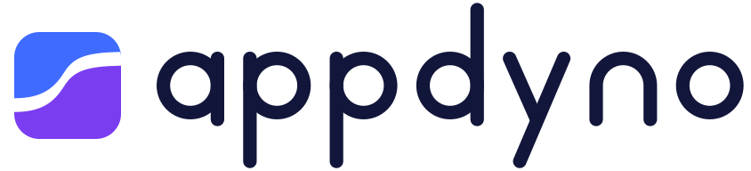
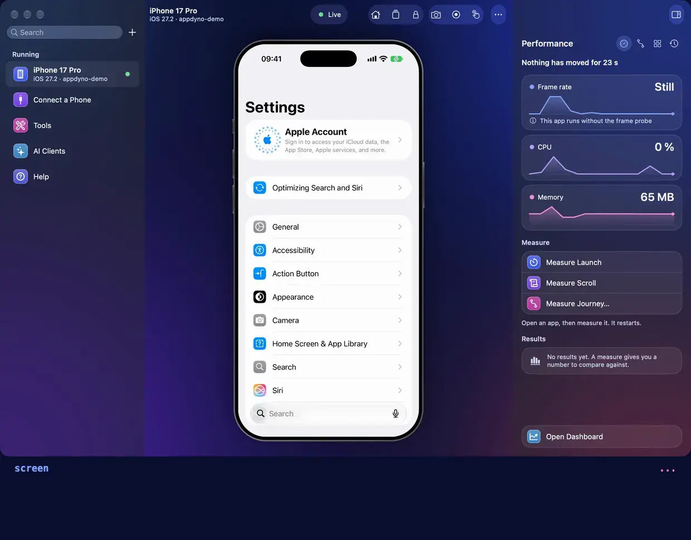
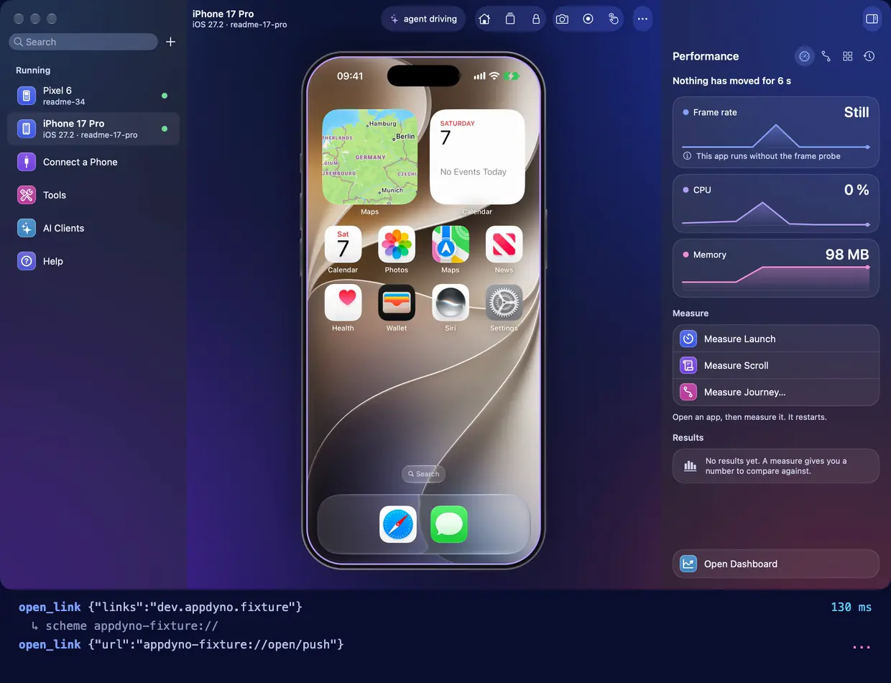
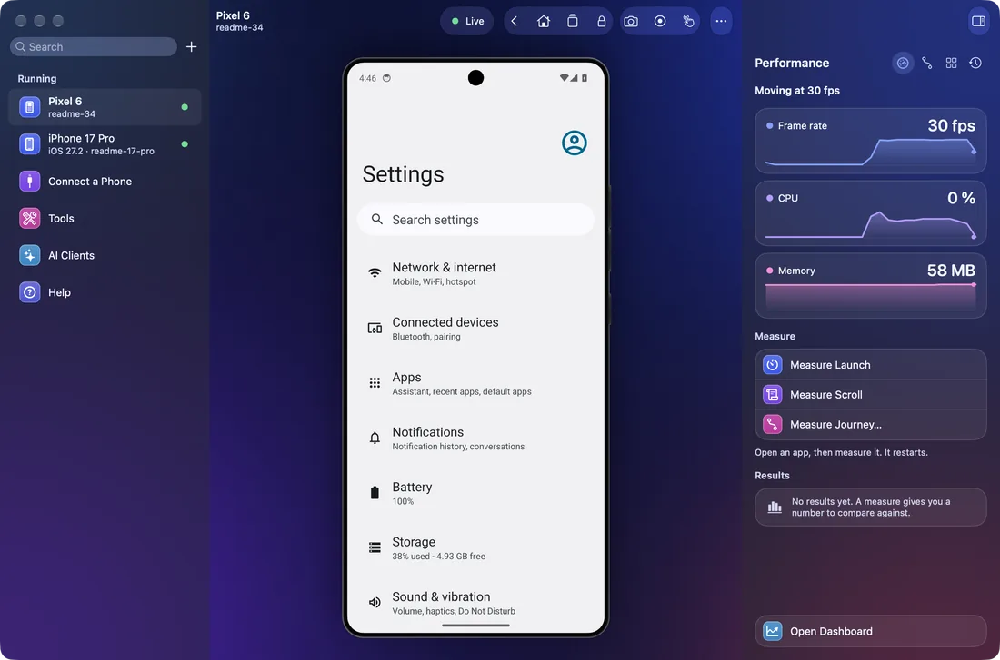
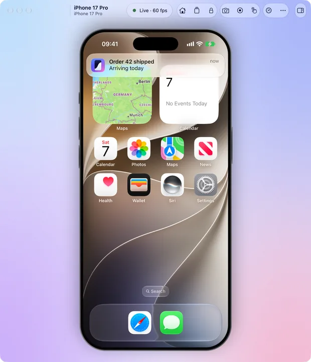
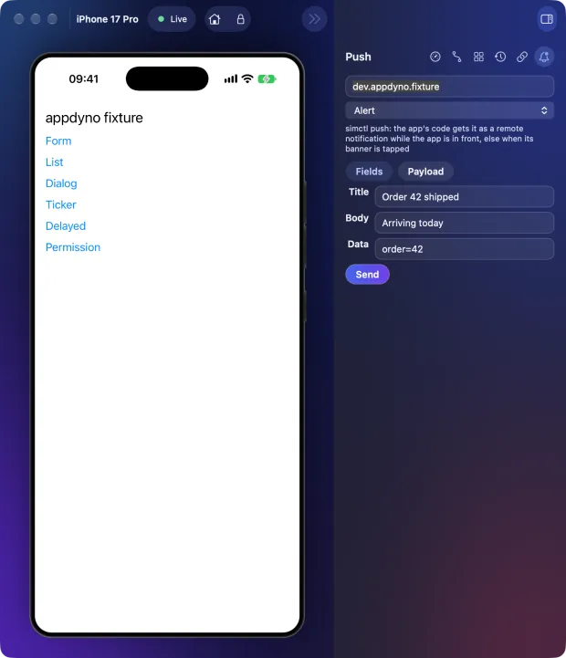

<h1 align="center">
  <picture>
    <source media="(prefers-color-scheme: dark)" srcset="docs/images/logo.dark.svg">
    
  </picture>
</h1>

<p align="center">
  <b>Let an AI agent drive, test and measure your mobile app.</b><br>
  An MCP server, a command line and a Mac app for iOS and Android,<br>
  on simulators, emulators and real phones.
</p>

<div align="center">

**English** · [Türkçe](README.tr.md)

</div>



<p align="center"><sub>A real run, not a mock-up: an MCP client makes the calls in the terminal, with their real times, while the hub shows the phone and reads it.</sub></p>

An agent reads the screen as elements, taps, types and swipes. It sends a push, opens a deep link, and measures how the app starts, scrolls and holds its memory. Every action answers with the screen once it has settled, so the agent sees what it did in the same call. You can watch and touch the same device in a live window. It all runs on your Mac, with no cloud and no telemetry.

Works with Claude Code, Claude Desktop, Codex, ChatGPT, Cursor, VS Code, Windsurf, Antigravity, Gemini CLI, Zed, opencode, Cline and any other MCP client.

## One call, one answer

<picture>
  <source media="(prefers-color-scheme: dark)" srcset="docs/images/one-call.dark.svg">
  
</picture>

There is no second call to look, and no fixed sleep: an answer says `settled` when the screen came to rest, and `changed` when it differs from before. A refusal has a code and a hint for the next step.

## What an agent can do

| what an agent can do                                                                                                                                                                        | its tools                                                              |
| ------------------------------------------------------------------------------------------------------------------------------------------------------------------------------------------- | ---------------------------------------------------------------------- |
| **See and act.** Read the screen as elements and act on one by text, id or ref: tap, type, swipe, scroll to it, long press, drag, pinch, press a key. Up to 30 steps in one call.           | `screen` `find` `tap` `type_text` `swipe` `gesture` `steps` `wait_for` |
| **Push notifications.** Send a push of each type the device takes, from a title and a body or from the platform's own JSON.                                                                 | `push`                                                                 |
| **Links.** Open a deep link, a universal link or an App Link. List the links an installed app opens.                                                                                        | `open_link`                                                            |
| **Conditions.** Dark mode, text size, language, a slow network, airplane mode and biometrics, each put back when the session ends. A location, and the way the screen is turned.            | `device_setting` `set_location` `set_orientation`                      |
| **Measure.** Launch time, frames, memory, CPU, network bytes and energy, read from the platform's own tools and kept with their raw output. A gate fails a change that made the app slower. | `perf_launch` `perf_scroll` `perf_snapshot` `perf_compare` and more    |
| **Evidence.** Video, a report of each step, logs, crashes, network traffic, accessibility audits and visual diffs.                                                                          | `record` `report` `logs` `crashes` `network` `audit` `visual`          |
| **Flows.** What an agent did once runs again with no model, on another device, and in CI.                                                                                                   | `flow`                                                                 |
| **A person, too.** A live window you can touch while the agent drives. When only a person can go on, such as at Face ID, the agent asks one and waits until they say done.                  | `mirror` `hand_off`                                                    |

All 48 tools are in [Tools](docs/reference/tools.md), and each is a call in [the library](docs/reference/library.md) too.

### Push notifications and links



<p align="center"><sub>A real run on a simulator, through MCP, with the times it took on a busy Mac.</sub></p>

`push` sends a push by type, and answers with the screen after it. Asked with no type, it says which types this device takes, the way each one goes, and the payload it would send.

- **On a simulator** an alert goes by `simctl` and reaches the app's own code, from fields or from APNs' own payload with a badge, a sound and a category.
- **On Android** the shell posts a notification in each style, alert, rich, inbox, messaging and media, which the app's code does not see. `tapped` opens the app with its data in the launcher activity's extras, where a tapped push puts it.
- **With APNs set up** by a person, with `appdyno push setup apns`, a simulator also takes rich, background, Live Activity, VoIP and widget pushes by APNs' sandbox, and a real iPhone on its cable takes those and an alert. Behind strict controls: the sandbox by default, a token only from the app's own log or typed by a person in a window's Push pane, 4 KB at most (5 for VoIP), 10 pushes a minute, and no key or token in any answer or log.
- **With FCM set up**, with `appdyno push setup fcm`, an Android device takes alert, rich, background and Live Activity pushes by FCM, behind the same kind of controls.

Until APNs is set up, a real iPhone takes no push, and the answer says so. The requests to Apple and Google are tested against recorded ones, and the sending to Apple against a local stand-in server: no push has gone through Apple's or Google's servers from here yet.

`open_link` opens a deep link, a universal link or an App Link and answers with the screen it led to. Given an app's id, it lists the links that app opens: on a simulator its URL schemes and the domains its signature names, on Android each filter as `scheme://host/path` and each App Link domain with the state Android verified it in.

[Push notifications](docs/reference/tools.md#push-notifications) has every type on every device, and what was run on what.

### The live window and the hub



`appdyno hub` opens every device on this Mac in one window, driven by mouse and keyboard while an agent drives it too. Its Performance pane reads frames, CPU and memory as they happen. AI Clients shows each MCP client on this Mac as it truly stands, and adds appdyno to it. A phone joins by cable, or by Wi-Fi once paired with `appdyno pair`. See [The window and the hub](docs/reference/mirror.md).

<p>
  
  
</p>

<p align="center"><sub>A device's own window, light and dark. Its Push pane sends by <code>push</code>, as an agent does, with the types this device takes.</sub></p>

### A person approves what loses data

<picture>
  <source media="(prefers-color-scheme: dark)" srcset="docs/images/approval.dark.svg">
  
</picture>

Nothing the agent sends counts as a yes, and no tool erases or resets a device. [What asks the person first](docs/reference/tools.md#what-asks-the-person-first) lists each action, and how a person allows them ahead.

## On each device

<picture>
  <source media="(prefers-color-scheme: dark)" srcset="docs/images/devices.dark.svg">
  
</picture>

| device           | what it needs                                                                   |
| ---------------- | ------------------------------------------------------------------------------- |
| iOS simulator    | Xcode. No account and no signing                                                |
| iPhone           | Xcode, Developer Mode, and a development signing identity with a profile for it |
| Android emulator | adb, from Android Studio or Google's platform tools                             |
| Android phone    | adb, and USB debugging. Wi-Fi once paired                                       |

[What works where](docs/reference/perf.md#what-works-where) has every measure on every device, and how each was proved. An iPhone's live picture is experimental, and rests on undocumented Apple services that may change.

## Install

appdyno is not on npm yet, and has no release yet, so today it installs from a checkout of this repository. Once it is published, `npx -y appdyno install` will do steps 2 and 3 in one command, with nothing to build.

**1. What you need**

| for                           | you need                                                                   |
| ----------------------------- | -------------------------------------------------------------------------- |
| appdyno                       | a Mac, and Node 22 or newer                                                |
| building it from a checkout   | pnpm 12, a JDK 25 and the Android SDK, for the agent it builds for Android |
| an iOS simulator or an iPhone | Xcode                                                                      |
| an Android emulator or phone  | `adb`, from Android Studio or Google's platform tools                      |

**2. Get appdyno**

```sh
git clone https://github.com/fatihcimen/appdyno.git
cd appdyno
mise install               # Node 26, pnpm 12 and a JDK 25, from .mise.toml, if you use mise
sh scripts/install.sh      # builds this checkout and installs the appdyno command
```

The Mac app needs no terminal and carries its own Node, on Apple silicon with macOS 13.5 or newer. Until a release has one, a checkout builds it: `pnpm build && node scripts/build-app.mjs` leaves it in `.app-build`. See [The Mac app](docs/guides/clients.md#the-mac-app).

**3. Add it to your MCP client**

```sh
appdyno install --dry-run  # shows the change for each client it finds, and writes nothing
appdyno install            # asks which clients; --yes takes all of them
```

It changes the one entry of appdyno's, keeps a backup beside the file, and `appdyno install --remove` takes it out. Restart the client afterwards. For any other client, add this to its server list:

```json
{
  "mcpServers": {
    "appdyno": { "command": "npx", "args": ["-y", "appdyno", "mcp"] }
  }
}
```

**4. Get a device ready**

- **iOS simulator**: nothing more. Start one in Xcode's Simulator, or ask your agent to. `appdyno ios build` builds appdyno's helper ahead, as the first action would, which takes a few minutes.
- **Android emulator**: create one in Android Studio's Device Manager and start it.
- **Android phone**: turn on Developer options (Settings, About phone, tap Build number seven times), then USB debugging in them. Connect the cable and answer Allow on the phone. For Wi-Fi, pair once under Wireless debugging, Pair device with pairing code: `appdyno pair <address> <code>`.
- **iPhone**: connect the cable and answer Trust, turn on Developer Mode, and give it a development signing identity with a profile: [An iPhone or a simulator](docs/guides/clients.md#an-iphone-or-a-simulator) takes you through it. For Wi-Fi, pair once on the cable: `appdyno pair --device <udid>`.

**5. Check**

```sh
appdyno doctor             # what is here, what is missing, and how to fix it
appdyno devices            # what is connected
```

[Connecting a client](docs/guides/clients.md) ([Türkçe](docs/guides/clients.tr.md)) takes each client step by step, and gets a phone ready from nothing, signing included.

## A first run

With a simulator, an emulator or a phone connected, ask your agent:

> Open Settings, turn on dark mode, and show me what changed.

> Send my app a push that says "Order 42 shipped", and show me what the app did with it.

> List the links my app opens, open each one, and tell me where it lands.

> Measure my app's cold launch, and keep it as a baseline.

Or run it yourself:

```sh
appdyno devices                # what is connected
appdyno screen                 # what is on the screen
appdyno hub                    # every device in one window you can touch
appdyno perf survey --app A    # every measure on this device, then a page of them
```

`appdyno doctor` says what is missing, and how to fix it.

## Speed

Medians of 5 runs, through MCP over stdio, on the fixture app, on an M5 Pro, on 2026-11-07. The iPhone is a 13 Pro Max, and the Android phone a Samsung SM-A525F:

| call              | iOS simulator | Android emulator | iPhone   | Android phone |
| ----------------- | ------------- | ---------------- | -------- | ------------- |
| read the screen   | 16 ms         | 40 ms            | 954 ms   | 54 ms         |
| tap by coordinate | 904 ms        | 797 ms           | 1,139 ms | 949 ms        |
| tap by selector   | 1,134 ms      | 847 ms           | 1,069 ms | 1,073 ms      |
| type into a field | 1,271 ms      | 635 ms           | 2,287 ms | 1,023 ms      |
| screenshot        | 90 ms         | 24 ms            | 183 ms   | 184 ms        |

A tap waits until the screen has been still for 200 ms and answers with what changed, so most of its time is the app's own. `node scripts/speed.mjs <device id>` runs the same calls on your Mac. [Speed](docs/reference/perf.md#speed) has every call, where the time goes, and what each one proves.

## Documentation

| read                                                | to                                                                      |
| --------------------------------------------------- | ----------------------------------------------------------------------- |
| [Connecting a client](docs/guides/clients.md)       | join appdyno to your MCP client and get a phone ready                   |
| [Flows](docs/guides/flows.md)                       | record what an agent did, replay it with no model, run it in CI         |
| [Evidence](docs/guides/evidence.md)                 | leave a video, a report, a network log or a visual diff behind          |
| [Measuring performance](docs/guides/performance.md) | measure an app, keep a baseline, and fail a change that makes it slower |
| [Tools](docs/reference/tools.md)                    | every tool, and what each platform can and cannot do                    |
| [How it is built](docs/architecture.md)             | how the parts fit, for someone about to change them                     |

[The documentation](docs/README.md) has the rest of the reference.

## Security

Local only: no network listener by default, no telemetry, and you decide which devices, apps and links it may touch. Use a test device and test accounts. See [SECURITY.md](SECURITY.md).

## Contributing

See [CONTRIBUTING.md](CONTRIBUTING.md) and the [Code of Conduct](CODE_OF_CONDUCT.md). `CHANGELOG.md` lists the releases.

## License

MIT. See [LICENSE](LICENSE).
