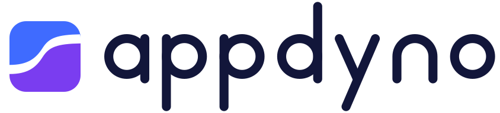
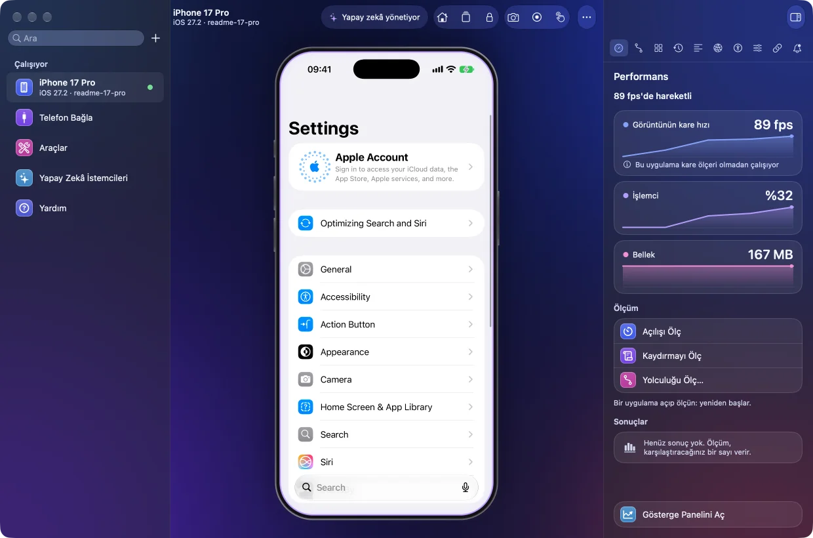
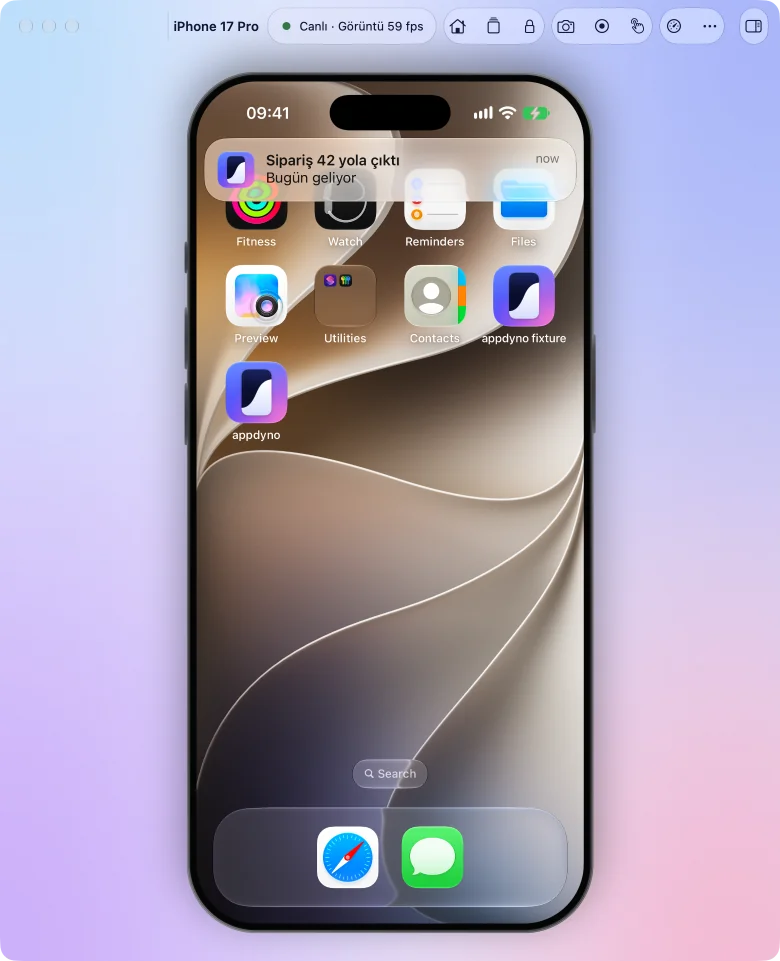
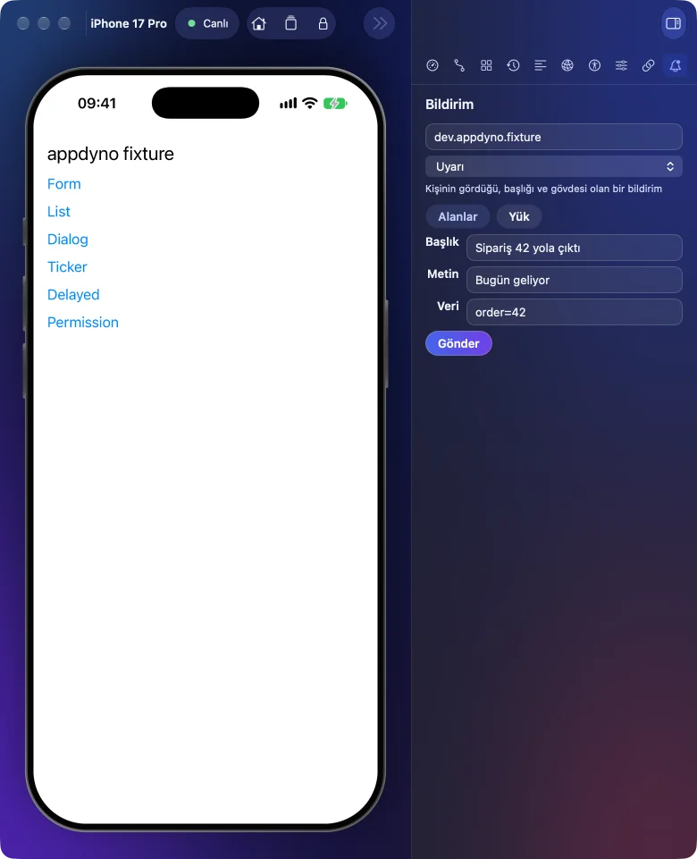

<h1 align="center">
  <picture>
    <source media="(prefers-color-scheme: dark)" srcset="docs/images/logo.dark.svg">
    
  </picture>
</h1>

<p align="center">
  <b>Bir mobil hatayı yeniden üretin, nedenini ölçümlerle bulun ve aynı flow'u yeniden çalışan bir teste dönüştürün.</b><br>
  appdyno ile bir yapay zekâ ajanı iOS ve Android uygulamanızı kullanır, test eder ve ölçer.<br>
  Bir MCP sunucusu, bir komut satırı aracı, bir TypeScript kütüphanesi ve bir Mac uygulaması: simulator'da, emulator'da ve gerçek telefonda.
</p>

<div align="center">

[English](README.md) · **Türkçe**

[](https://www.npmjs.com/package/appdyno)
[](https://github.com/fatihcimen/appdyno/actions/workflows/ci.yml)
[](LICENSE)

</div>


<p align="center"><sub>Kurgu değil, gerçek bir çalıştırma: çağrıları bir MCP istemcisi yapıyor, süreler gerçek. Hub ise telefonu gösteriyor ve okuyor. Kayıt İngilizce arayüzle alındı; uygulama Türkçe de çalışır.</sub></p>

Ajan ekranı öğeler halinde okur; dokunur, yazar, kaydırır. Push bildirimi gönderir, deep link açar, uygulamanın nasıl açıldığını, nasıl kaydığını ve ne kadar bellek tuttuğunu ölçer. Her işlem, ekran durulduktan sonraki haliyle yanıt verir: ajan yaptığı işin sonucunu aynı çağrıda görür. Siz de aynı cihazı canlı bir pencerede izleyip elle kullanabilirsiniz. Hepsi Mac'inizde çalışır; bulut yok, telemetri yok.

Yerel bir sunucu başlatabilen her MCP istemcisiyle çalışır. Her birinin durumu:

|                               | istemciler                                                                                       | ne yapıldı                                                                                                                                                                                                                                                                                |
| ----------------------------- | ------------------------------------------------------------------------------------------------ | ----------------------------------------------------------------------------------------------------------------------------------------------------------------------------------------------------------------------------------------------------------------------------------------- |
| **Test edildi**               | Claude Code, Gemini CLI, opencode                                                                | her biri 2026-11-04'te bağlandı ve araçları listeledi: Claude Code 2.1.318 stdio ve HTTP üzerinden, Gemini CLI 0.66.0, opencode 1.19.5. Claude Code 2.1.319 ardından 2026-11-08 ve 2026-11-09'da bir iPhone 17 Pro simulator'ına (iOS 27.2) ve bir API 34 emulator'ına karşı çalıştırıldı |
| **Kuruldu, henüz bağlanmadı** | Codex, Cline                                                                                     | `appdyno install` her birinin dosyasını yazdı; Codex CLI 0.166.0 ve Cline CLI 3.0.74 dosyayı okudu ve appdyno'yu listeledi, ama 2026-11-04'te ikisi de bağlanmadı                                                                                                                         |
| **Çalışması beklenir**        | Claude Desktop, ChatGPT, Cursor, VS Code, Devin Desktop (eski adıyla Windsurf), Antigravity, Zed | denenmedi: her biri bir hesap, bir lisans ya da bir pencere ister. `appdyno install` her birinin dosyasını kendi belgelerinin dediği gibi yazar                                                                                                                                           |

Her çalıştırma [Neyle denendi](docs/guides/clients.tr.md#neyle-denendi) bölümündedir.

## Hızlı başlangıç

Node 22 ya da daha yenisi kurulu bir Mac'te:

```sh
npx -y appdyno install     # appdyno'yu bu Mac'teki MCP istemcilerine ekler, hangilerine olduğunu sorar
```

İstemciyi yeniden başlatın, bir simulator ya da emulator açın veya bir telefon bağlayın ve ajanınıza sorun:

> Uygulamamı aç, ödeme adımlarından geç ve neyin bozulduğunu söyle.

Her adım, cihazın gösterdiğiyle yanıt verir. Bir dokunuş uygulamayı çökertirse aynı yanıt bunu crash'le ve uygulamanın son log satırlarıyla birlikte söyler. Bu deponun [alışveriş örneğinden](docs/examples/shop/README.tr.md), bir iPhone simulator'ında alınmış gerçek bir yanıt; bir üründen üç tane siparişi düşürüyor:

```text
APP_NOT_RUNNING: tapped @7rwa "Place order"; the app died: EXC_BREAKPOINT SIGTRAP Trace/BPT trap: 5 (~/Library/Logs/DiagnosticReports/Shop-….ips)
its last log lines:
2026-11-13 15:04:41.624 Df Shop[46315:14884fe] (libswiftCore.dylib) Swift/ContiguousArrayBuffer.swift:695: Fatal error: Index out of range
  launch_app starts it again; why it died is above, with its last log lines, and read_logs with source crashes has the whole report
```

Ardından `source: crashes` ile `read_logs` fonksiyonun adını verir, `discount(forQuantity:)`; aynı ödeme bir flow olarak kaydedildiğinde de hata düzeltilene kadar CI'da başarısız olur.

Ajandan uygulamanıza bir push göndermesini, uygulamanızın açtığı her bağlantıyı açmasını ya da cold launch'ını ölçüp baseline olarak saklamasını da isteyebilirsiniz. `npx -y appdyno doctor` bu Mac'te neyin eksik olduğunu söyler; [Kurulum](#kurulum) telefonu, Mac uygulamasını ve diğer istemcileri anlatır.

## Tek çağrı, tek yanıt

<picture>
  <source media="(prefers-color-scheme: dark)" srcset="docs/images/one-call.tr.dark.svg">
  
</picture>

Ne olduğuna bakmak için ikinci bir çağrı gerekmez, sabit bir bekleme de yoktur. Ekran durulduysa yanıtta `settled`, öncekinden farklıysa `changed` yazar. Reddedilen bir çağrı bir kod ve sonraki adım için bir ipucu taşır.

## Bir ajan neler yapabilir

| bir ajan neler yapabilir                                                                                                                                                                                                                                         | araçları                                                                                      |
| ---------------------------------------------------------------------------------------------------------------------------------------------------------------------------------------------------------------------------------------------------------------- | --------------------------------------------------------------------------------------------- |
| **Görmek ve dokunmak.** Ekranı öğeler halinde okur, bir öğeyi metniyle, id'siyle ya da ref'iyle bulur: dokunur, yazar, kaydırır, öğeyi bulana kadar kaydırır, uzun basar, sürükler, pinch yapar, tuşa basar. Tek çağrıda 30 adıma kadar.                         | `read_screen` `tap_screen` `type_text` `swipe_screen` `press_key` `run_steps` `check_element` |
| **Yerel görünümler.** Görünüm ağacını onu çizen çatının altında verir: SwiftUI, UIKit, Compose, Flutter, React Native ya da bir web görünümü; bir simulator'da ve Android'de.                                                                                    | `read_screen` `views`                                                                         |
| **Push bildirimleri.** Cihazın kabul ettiği her türde push gönderir; bir başlık ve metinden ya da platformun kendi JSON'undan.                                                                                                                                   | `send_push`                                                                                   |
| **Bağlantılar.** Deep link, universal link ya da App Link açar. Kurulu bir uygulamanın açtığı bağlantıları listeler.                                                                                                                                             | `open_link`                                                                                   |
| **Cihaz koşulları.** Karanlık mod, yazı boyutu, dil, yavaş ağ, uçak modu ve biyometri; her biri oturum bitince eski haline döner. Konum ve ekranın yönü de. Bir bellek uyarısı, bir sallama, kitaplığa fotoğraflar ve sistemin yaptığı gibi arka planda bir son. | `set_device` `transfer_files` `manage_app`                                                    |
| **Ölçüm.** Açılış süresi, kareler, bellek, CPU, ağ verisi ve enerji; platformun kendi araçlarından okunur, ham çıktısıyla saklanır. Performans kapısı, uygulamayı yavaşlatan bir değişikliği başarısız kılar.                                                    | `measure_performance` `compare_performance`                                                   |
| **Kanıt.** Video, her adımın raporu, loglar, crash kayıtları, ağ trafiği, erişilebilirlik denetimi ve görsel karşılaştırma.                                                                                                                                      | `record_session` `read_logs` `capture_network` `check_screen`                                 |
| **Flow'lar.** Ajanın bir kez yaptığı iş, model olmadan, başka bir cihazda ve CI'da yeniden çalışır.                                                                                                                                                              | `run_flow`                                                                                    |
| **İnsan da işin içinde.** Ajan cihazı kullanırken sizin de dokunabildiğiniz canlı bir pencere. Face ID gibi yalnızca bir insanın geçebileceği bir yerde ajan size sorar ve "tamam" diyene kadar bekler.                                                          | `show_mirror` `ask_person`                                                                    |

28 aracın hepsi [Araçlar](docs/reference/tools.tr.md) sayfasında; [1.3.0'dan önceki adlar](docs/reference/tools.tr.md#130dan-önceki-adlar) da orada. Her biri aynı zamanda [bir komut](docs/reference/cli.tr.md) ve [kütüphanede](docs/reference/library.tr.md) bir çağrıdır.

### Push bildirimleri ve bağlantılar


<p align="center"><sub>Bir simulator'da, MCP üzerinden gerçek bir çalıştırma; süreler, yükü yüksek bir Mac'te ölçüldüğü gibi.</sub></p>

`send_push`, bildirimi türüne göre gönderir ve sonraki ekranla yanıt verir. Tür verilmezse bu cihazın hangi türleri kabul ettiğini, her birinin hangi yoldan gittiğini ve göndereceği payload'u söyler.

- **Simulator'da** alert `simctl` ile gider ve doğrudan uygulamanın koduna ulaşır: alanlardan ya da badge, ses ve kategori içeren APNs payload'unun kendisinden.
- **Android'de** push her zaman uygulamanın kendisine gider. Firebase Messaging içeren debuggable bir build alert, rich, background ve Live Activity push'larını gerçek FCM mesajları olarak, doğrudan Firebase SDK'sına teslim edilmiş halde alır; Firebase projesi ya da anahtar gerekmez. `tapped`, uygulamayı dokunulmuş bir bildirimin açtığı gibi, push'un verisi onu başlatan intent'te olacak şekilde açar. Başka bir build yalnızca `tapped` alır; yanıt, diğerleri için neyin gerektiğini söyler.
- **APNs kurulduğunda**, yani bir kişi `appdyno push setup apns` ile kurduğunda, simulator APNs'in sandbox'ı üzerinden rich, background, Live Activity, VoIP ve widget push'larını da alır; kabloyla bağlı gerçek bir iPhone da bunları ve alert'i alır. Kurallar sıkıdır: varsayılan olarak sandbox; token yalnızca uygulamanın kendi logundan ya da bir kişinin pencerenin Bildirim panelinde yazdığından; en çok 4 KB (VoIP için 5); dakikada 10 push; hiçbir yanıtta ya da logda anahtar ya da token yok.
- **FCM kurulduğunda**, `appdyno push setup fcm` ile, Android cihaz alert, rich, background ve Live Activity push'larını FCM üzerinden alır; kurallar aynı türdendir.

APNs kurulana kadar gerçek bir iPhone push almaz, yanıt da bunu söyler. FCM'in kendi mesajı API 34 bir emulator'da, veri push'ları da bir Samsung telefonda denendi. Apple'a ve Google'a giden istekler kaydedilmiş isteklerle, Apple'a gönderim de yerel bir test sunucusuyla sınanır: denemelerde henüz Apple'ın ya da Google'ın kendi sunucularından geçen bir push gönderilmedi.

`open_link` bir deep link, universal link ya da App Link açar ve vardığı ekranla yanıt verir. Bir uygulamanın kimliği verilirse o uygulamanın açtığı bağlantıları listeler: simulator'da URL şemalarını ve imzasında adı geçen alan adlarını, Android'de her filtreyi `scheme://host/path` biçiminde ve her App Link alan adını Android'in doğrulama durumuyla.

Her türün her cihazdaki durumu ve neyin nerede denendiği: [Push bildirimleri](docs/reference/tools.tr.md#push-bildirimleri).

### Canlı pencere ve hub



`appdyno hub`, bu Mac'teki bütün cihazları tek pencerede açar. Ajan bir cihazı kullanırken siz de fare ve klavyeyle kullanabilirsiniz. Performans paneli kareleri, CPU'yu ve belleği anında okur. Yapay Zekâ İstemcileri, bu Mac'teki her MCP istemcisini gerçek durumuyla gösterir ve appdyno'yu ona ekler. Telefon kabloyla bağlanır; `appdyno pair` ile bir kez eşleştirildikten sonra Wi-Fi ile de. Ayrıntılar: [Pencere ve hub](docs/reference/mirror.tr.md).

<p>
  
  
</p>

<p align="center"><sub>Bir cihazın kendi penceresi, açık ve koyu görünümüyle. Bildirim paneli, bir ajanın yaptığı gibi <code>push</code> ile gönderir; bu cihazın kabul ettiği türlerle.</sub></p>

### Veri kaybettiren işi kişi onaylar

<picture>
  <source media="(prefers-color-scheme: dark)" srcset="docs/images/approval.tr.dark.svg">
  
</picture>

Ajanın gönderdiği hiçbir şey evet sayılmaz; hiçbir araç bir cihazı silmez ya da sıfırlamaz. Hangi işlemlerin önce kişiye sorulduğu ve kişinin bunlara nasıl önceden izin verdiği: [Önce kişiye sorulanlar](docs/reference/tools.tr.md#önce-kişiye-sorulanlar).

## Hangi cihazda ne çalışır

<picture>
  <source media="(prefers-color-scheme: dark)" srcset="docs/images/devices.tr.dark.svg">
  
</picture>

| cihaz              | gerekenler                                                             |
| ------------------ | ---------------------------------------------------------------------- |
| iOS simulator'ı    | Xcode. Hesap da imzalama da gerekmez                                   |
| iPhone             | Xcode, Geliştirici Modu, bir geliştirme imzası ve ona ait bir profil   |
| Android emulator'ı | Android Studio'dan ya da Google'ın platform-tools paketinden gelen adb |
| Android telefon    | adb ve USB hata ayıklama. Bir kez eşleştirildikten sonra Wi-Fi         |

Her ölçümün her cihazdaki durumu ve nasıl kanıtlandığı: [Ne nerede çalışır](docs/reference/perf.tr.md#ne-nerede-çalışır). iPhone'un canlı görüntüsü deneyseldir; Apple'ın belgelenmemiş, değişebilecek servislerine dayanır.

## Kurulum

appdyno'yu nasıl kullanacağınıza göre en kısa yol:

| istediğiniz                         | yapmanız gereken                                                                                                                                                                                                                                   |
| ----------------------------------- | -------------------------------------------------------------------------------------------------------------------------------------------------------------------------------------------------------------------------------------------------- |
| MCP istemcinizde appdyno            | `npx -y appdyno install`, ardından istemciyi yeniden başlatın. Hangi istemcilere ekleneceğini sorar; `--dry-run` değişikliği önce gösterir                                                                                                         |
| terminalsiz, masaüstü eklentisi     | `appdyno-<version>.mcpb` dosyasını [son sürümden](https://github.com/fatihcimen/appdyno/releases/latest) indirin ve Claude Desktop'ta açın. Dosyadan çıkan sunucuyu `scripts/check-mcpb.mjs` çalıştırır; dosyayı uygulamada açmak burada denenmedi |
| terminalsiz, Mac uygulaması         | `Appdyno-<version>-arm64.dmg` dosyasını [sürümler](https://github.com/fatihcimen/appdyno/releases) sayfasından indirin, Applications'a sürükleyin ve menü çubuğundan Add to MCP Clients'ı seçin                                                    |
| bir TypeScript projesinde kütüphane | `npm install appdyno`, ardından `import { connect } from 'appdyno'`: bkz. [Kütüphane](docs/reference/library.tr.md)                                                                                                                                |

Her biri bir Mac ve kullanılacak bir cihaz ister: [4. adım](#4-cihazı-hazırlayın) bir cihazı hazırlar. `npx -y appdyno` çalıştıran bir istemci her açılışta npm'e son sürümü sorar: 2. ve 3. adımlar tek bir sürümü kurar ve onu korur. Aşağıdaki adımlar aynı yolların ayrıntılı halidir.

### 1. Gerekenler

| ne için                          | gereken                                                                                                                                           |
| -------------------------------- | ------------------------------------------------------------------------------------------------------------------------------------------------- |
| appdyno                          | bir Mac ve Node 22 ya da üstü. Mac uygulaması kendi Node'unu taşır; npm'den kurulunca merkezin penceresi Xcode'u ya da Command Line Tools'u ister |
| iOS simulator'ı ya da iPhone     | Xcode ve iOS 17 ya da üstü                                                                                                                        |
| Android emulator'ı ya da telefon | Android Studio'dan ya da Google'ın platform-tools paketinden gelen `adb` ve Android 8.0 (API 26) ya da üstü                                       |

### 2. appdyno'yu edinin

```sh
npm install -g appdyno     # appdyno komutunu kurar
```

Ya da terminal istemeyen Mac uygulamasını alın: `Appdyno-<version>-arm64.dmg` dosyasını [sürümler](https://github.com/fatihcimen/appdyno/releases) sayfasından indirip Applications'a sürükleyin. Apple silicon işlemcili, macOS 13.5 ya da üstü bir Mac'te çalışır; menü çubuğundaki Add to MCP Clients da 3. adımı yapar. Bkz. [Mac uygulaması](docs/guides/clients.tr.md#mac-uygulaması). appdyno'yu bunun yerine kaynak koddan derlemek için bkz. [CONTRIBUTING.tr.md](CONTRIBUTING.tr.md).

### 3. MCP istemcinize ekleyin

```sh
appdyno install --dry-run  # bulduğu her istemci için değişikliği gösterir, hiçbir şey yazmaz
appdyno install            # hangi istemcilere ekleneceğini sorar; --yes hepsini seçer
```

Yalnızca appdyno'nun girdisini değiştirir, dosyanın yanına bir yedek bırakır; `appdyno install --remove` girdiyi kaldırır. Ardından istemciyi yeniden başlatın. Başka bir istemci için şunu sunucu listesine ekleyin:

```json
{
  "mcpServers": {
    "appdyno": { "command": "npx", "args": ["-y", "appdyno", "mcp"] }
  }
}
```

Dock'tan açılan bir istemci `npx`'i bulamayabilir: `spawn npx ENOENT` derse [Uygulama npx'i veya adb'yi bulamıyor](docs/guides/clients.tr.md#uygulama-npxi-veya-adbyi-bulamıyor) bölümüne bakın.

Claude Desktop, appdyno'yu terminal olmadan tek bir dosyadan kurar: `appdyno-<version>.mcpb` dosyasını [son sürümden](https://github.com/fatihcimen/appdyno/releases/latest) indirip açın. Bkz. [Claude Desktop](docs/guides/clients.tr.md#claude-desktop).

### 4. Cihazı hazırlayın

- **iOS simulator'ı**: başka bir şey gerekmez. Xcode'un Simulator uygulamasından açın ya da ajanınızdan açmasını isteyin. appdyno'nun yardımcısını gerektiren ilk işlem, sürümün derlediği yardımcıyı (1 MB'tan küçük) sürümün GitHub'daki sayfasından indirir ve yalnızca sha256'sı paketin taşıdığıyla aynıysa kullanır; kullanamazsa bir tane derler, bu birkaç dakika sürer. `--no-fetch` ya da `APPDYNO_NO_FETCH=1` indirmeyi kapatır. `appdyno ios build` bunu simulator ve iPhone için önceden yapar; iPhone'un yardımcısı her zaman derlenir. Eski sürümlerin build'lerini de siler; çalışan bir sürecin hâlâ kullandığı build'e dokunmaz.
- **Android emulator'ı**: Android Studio'nun Device Manager'ında bir sanal cihaz oluşturup başlatın.
- **Android telefon**: geliştirici seçeneklerini açın (Ayarlar, Telefon hakkında, Derleme numarasına yedi kez dokunun), ardından orada USB hata ayıklamayı açın. Kabloyu takın ve telefonun sorusuna İzin ver deyin. Wi-Fi için bir kez eşleştirin: Kablosuz hata ayıklama altında eşleme koduyla eşleştirmeyi seçin ve telefonun gösterdiğiyle `appdyno pair <address> <code>` çalıştırın.
- **iPhone**: kabloyu takın ve Güven deyin, Geliştirici Modu'nu açın, bir geliştirme imzası ve ona ait bir profil verin: [iPhone veya simulator](docs/guides/clients.tr.md#iphone-veya-simulator) adım adım anlatır. Wi-Fi için kabloluyken bir kez eşleştirin: `appdyno pair --device <udid>`.

### 5. Kontrol edin

```sh
appdyno doctor             # neyin kurulu, neyin eksik olduğunu ve nasıl düzeltileceğini söyler
appdyno devices            # neler bağlı
appdyno read-screen        # ekranda ne var
appdyno hub                # bütün cihazlar, dokunabileceğiniz tek pencerede
appdyno perf survey --app com.example.app   # bu cihazdaki her ölçüm, ardından hepsini gösteren bir sayfa
```

[İstemci bağlamak](docs/guides/clients.tr.md) her istemciyi adım adım anlatır; hiçbir şey kurulu değilken bir telefonu, imzalama dahil, baştan nasıl hazırlayacağınızı gösterir.

## Gerçek uygulamalarda

Wikipedia'nın kendi deposundan derlenmiş debug build'i, hub'da bir Android emulator'ında: bir MCP istemcisi Istanbul'u arar, makaleyi açar, iki satıra bölünen bir bağlantıya dokunur, o makaleyi okur ve ölçer. Her çağrı gerçektir ve yanında aldığı süre yazar:


Makale ve resmi Wikipedia'nındır, kendi lisanslarıyla.

Beş açık kaynak uygulamanın yedi build'i, her biri deposunun derlediği gibi; bir Android emulator'ında (API 34) ve bir iOS simulator'ında (iOS 27.2) debug build'ler, bir M5 Pro'da, 2026-11-13'te:

| uygulama           | ne ile yazılmış                                      | cold launch | bellek | kaydırma                          |
| ------------------ | ---------------------------------------------------- | ----------- | ------ | --------------------------------- |
| Wikipedia, Android | Kotlin, view'lar, makaleler bir web view'da          | 2.098 ms    | 197 MB | %4,4 takılan, p95 30 ms           |
| Now in Android     | Kotlin, Jetpack Compose                              | 1.912 ms    | 179 MB | %3,3 takılan, p95 32 ms           |
| AntennaPod         | Java, view'lar                                       | 1.451 ms    | 107 MB | %1 takılan, p95 31 ms             |
| Wonderous, Android | Flutter                                              | 1.345 ms    | 188 MB | kendi yüzeyi: 60 fps, p95 16,7 ms |
| Wikipedia, iOS     | Swift, Objective-C, UIKit, makaleler bir web view'da | 3.191 ms    | 230 MB | %6,4 takılan, p95 32 ms           |
| NetNewsWire        | Swift, UIKit                                         | 2.492 ms    | 57 MB  | %2,1 takılan, p95 16,7 ms         |
| Wonderous, iOS     | Flutter                                              | 3.519 ms    | 298 MB | %2,1 takılan, p95 16,7 ms         |

Cold launch, bir ısınmanın ardından 5 açılışın medyanıdır: Android'de sistemin bildirdiği ilk kareye kadar geçen süre, simulator'da kare probunun gördüğü ilk kareye kadar geçen süre. Bellek, kaydırmadan sonra Android'in PSS'i ve iOS'un fiziksel ayak izidir. Kaydırma, 5 kaydırmalık 3 turun medyanıdır; Android'deki Wonderous kendine ait bir yüzeye, sistemin saydığı karelerin dışında çizer, bu yüzden onun yerine o yüzeyin kareleri okunur. Bir simulator'ın ve bir emulator'ın sayıları bu Mac'indir ve bir debug build, bir release build'den yavaştır: bir çalıştırmayı bir sonrakiyle karşılaştırırlar, bir telefonun ne kadar hızlı olduğunu söylemezler.

Onları denemek appdyno'da neyin düzeltilmesi gerektiğini gösterdi. LeakCanary'li bir debug build gibi iki başlatıcı etkinliği olan bir uygulama sistemin seçicisini başlatıyor ve 0 ms'lik bir cold launch ölçüyordu; iki satıra bölünen bir bağlantıya dokunuş da satırların arasına iniyordu. Her düzeltme [değişiklik kaydında](CHANGELOG.tr.md).

## Hız

5 çalıştırmanın medyanı; MCP üzerinden stdio ile, fixture uygulamasında, bir M5 Pro'da, 2026-11-10'da (telefonlar 2026-11-09'da). iPhone bir 13 Pro Max, Android telefon bir Samsung SM-A525F:

| çağrı                | iOS simulator'ı | Android emulator'ı | iPhone   | Android telefon |
| -------------------- | --------------- | ------------------ | -------- | --------------- |
| ekranı okumak        | 18 ms           | 11 ms              | 308 ms   | 49 ms           |
| koordinatla dokunmak | 890 ms          | 469 ms             | 970 ms   | 711 ms          |
| seçiciyle dokunmak   | 1.084 ms        | 696 ms             | 918 ms   | 989 ms          |
| bir alana yazmak     | 1.137 ms        | 648 ms             | 1.934 ms | 930 ms          |
| ekran görüntüsü      | 82 ms           | 28 ms              | 184 ms   | 166 ms          |

Dokunuş, ekran 200 ms boyunca durgun kalana kadar bekler ve neyin değiştiğini söyler; bu yüzden süresinin çoğu uygulamanın kendisine aittir. Bir kaynak kopyasında, `pnpm build` sonrasında ve fixture uygulaması cihazda kuruluyken `node scripts/speed.mjs <device id>` aynı çağrıları sizin Mac'inizde çalıştırır. Her çağrı, sürenin nereye gittiği ve her birinin neyi kanıtladığı: [Hız](docs/reference/perf.tr.md#hız).

## Belgeler

| okuyun                                              | ne için                                                                       |
| --------------------------------------------------- | ----------------------------------------------------------------------------- |
| [İstemci bağlamak](docs/guides/clients.tr.md)       | appdyno'yu MCP istemcinize bağlamak ve bir telefonu hazırlamak                |
| [Flow'lar](docs/guides/flows.tr.md)                 | ajanın yaptığını kaydetmek, model olmadan yeniden oynatmak, CI'da çalıştırmak |
| [Kanıt](docs/guides/evidence.tr.md)                 | geride bir video, rapor, ağ kaydı ya da görsel fark bırakmak                  |
| [Performansı ölçmek](docs/guides/performance.tr.md) | bir uygulamayı ölçmek, baseline tutmak, yavaşlatan değişikliği durdurmak      |
| [Araçlar](docs/reference/tools.tr.md)               | her araç, her platformun neyi yapıp neyi yapamadığı                           |
| [Nasıl yapıldığı](docs/architecture.tr.md)          | parçaların nasıl birleştiği, kodu değiştirecek olan için                      |

Diğer başvuru sayfaları [belgelerin dizininde](docs/README.tr.md).

## Güvenlik

Yalnızca yereldir: varsayılan olarak ağdan bağlantı dinlemez, telemetri yoktur; hangi cihazlara, uygulamalara ve bağlantılara dokunabileceğine siz karar verirsiniz. Test cihazı ve test hesapları kullanın. Bkz. [SECURITY.tr.md](SECURITY.tr.md).

## Katkıda bulunmak

Bkz. [CONTRIBUTING.tr.md](CONTRIBUTING.tr.md) ve [Davranış Kuralları](CODE_OF_CONDUCT.tr.md). Sürümler [CHANGELOG.tr.md](CHANGELOG.tr.md) dosyasında.

## Lisans

MIT. Bkz. [LICENSE](LICENSE).
