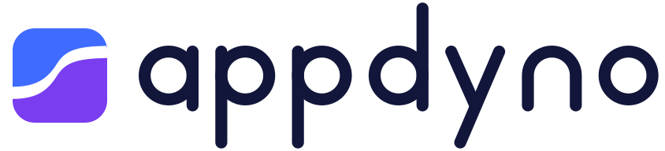
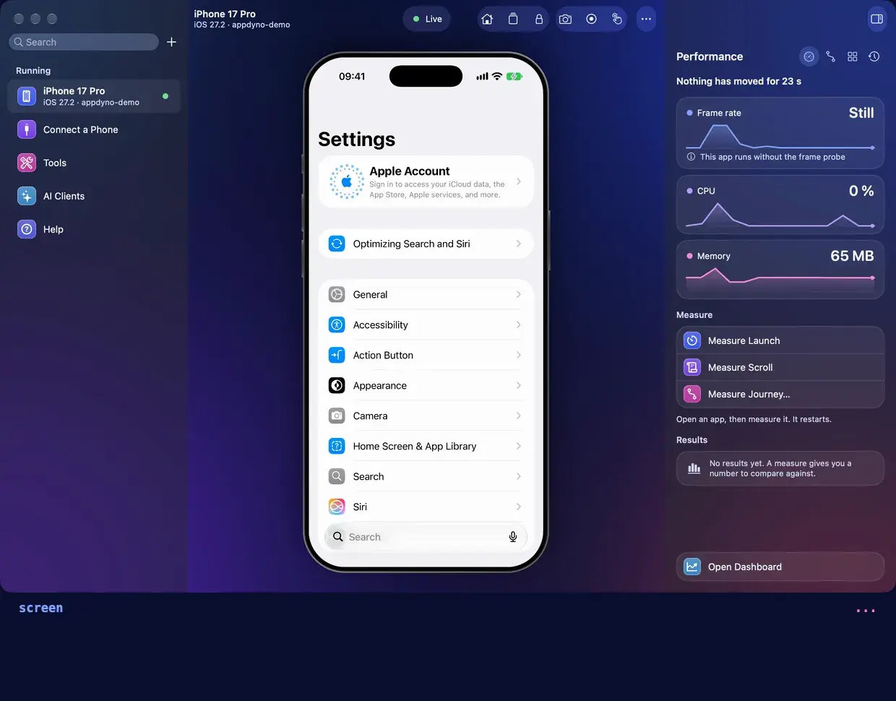
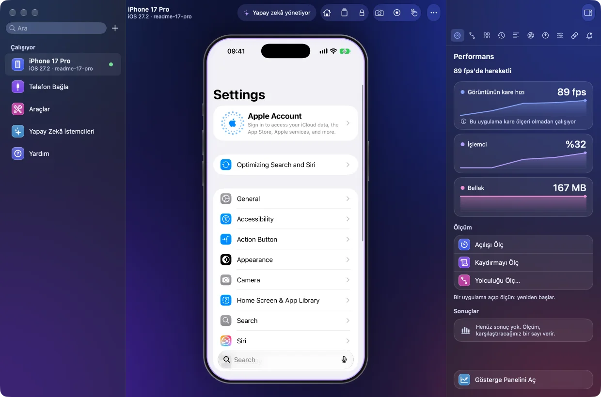
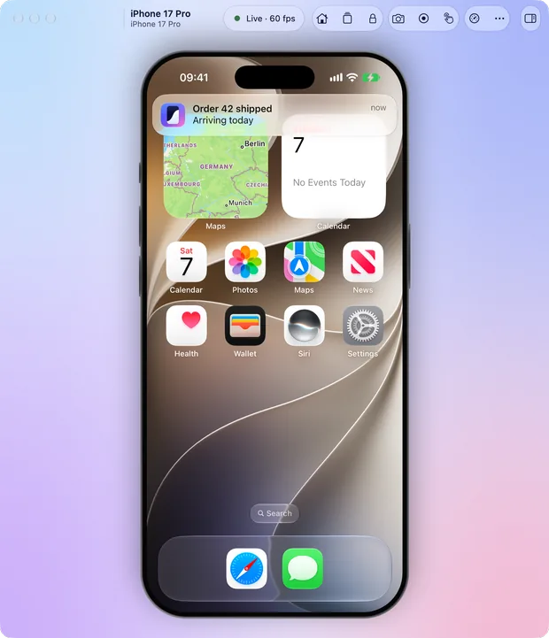
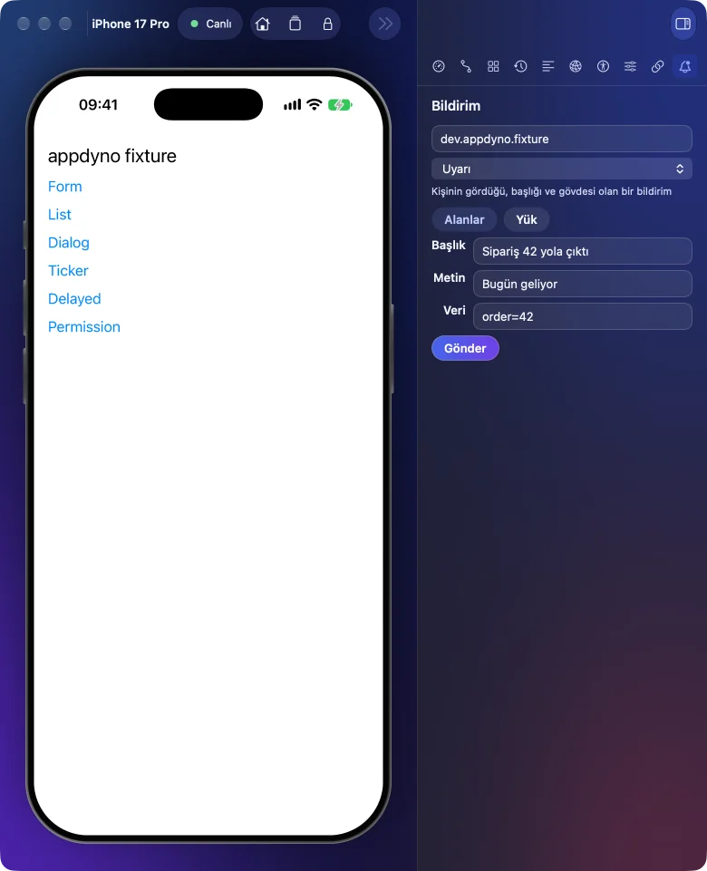

<h1 align="center">
  <picture>
    <source media="(prefers-color-scheme: dark)" srcset="docs/images/logo.dark.svg">
    
  </picture>
</h1>

<p align="center">
  <b>Mobil uygulamanızı bir yapay zekâ ajanı kullansın, test etsin, ölçsün.</b><br>
  iOS ve Android için bir MCP sunucusu, bir komut satırı aracı ve bir Mac uygulaması:<br>
  simülatörde, emülatörde ve gerçek telefonda.
</p>

<div align="center">

[English](README.md) · **Türkçe**

</div>



<p align="center"><sub>Kurgu değil, gerçek bir çalıştırma: çağrıları bir MCP istemcisi yapıyor, süreler gerçek. Hub ise telefonu gösteriyor ve okuyor.</sub></p>

Ajan ekranı öğeler halinde okur; dokunur, yazar, kaydırır. Push bildirimi gönderir, deep link açar, uygulamanın nasıl açıldığını, nasıl kaydığını ve ne kadar bellek tuttuğunu ölçer. Her işlem, ekran durulduktan sonraki haliyle yanıt verir: ajan yaptığı işin sonucunu aynı çağrıda görür. Siz de aynı cihazı canlı bir pencerede izleyip elle kullanabilirsiniz. Hepsi Mac'inizde çalışır; bulut yok, telemetri yok.

Claude Code, Claude Desktop, Codex, ChatGPT, Cursor, VS Code, Windsurf, Antigravity, Gemini CLI, Zed, opencode, Cline ve diğer tüm MCP istemcileriyle çalışır.

## Tek çağrı, tek yanıt

<picture>
  <source media="(prefers-color-scheme: dark)" srcset="docs/images/one-call.tr.dark.svg">
  
</picture>

Ne olduğuna bakmak için ikinci bir çağrı gerekmez, sabit bir bekleme de yoktur. Ekran durulduysa yanıtta `settled`, öncekinden farklıysa `changed` yazar. Reddedilen bir çağrı bir kod ve sonraki adım için bir ipucu taşır.

## Bir ajan neler yapabilir

| bir ajan neler yapabilir                                                                                                                                                                                                                 | araçları                                                                |
| ---------------------------------------------------------------------------------------------------------------------------------------------------------------------------------------------------------------------------------------- | ----------------------------------------------------------------------- |
| **Görmek ve dokunmak.** Ekranı öğeler halinde okur, bir öğeyi metniyle, id'siyle ya da ref'iyle bulur: dokunur, yazar, kaydırır, öğeyi bulana kadar kaydırır, uzun basar, sürükler, pinch yapar, tuşa basar. Tek çağrıda 30 adıma kadar. | `screen` `find` `tap` `type_text` `swipe` `gesture` `steps` `wait_for`  |
| **Push bildirimleri.** Cihazın kabul ettiği her türde push gönderir; bir başlık ve metinden ya da platformun kendi JSON'undan.                                                                                                           | `push`                                                                  |
| **Bağlantılar.** Deep link, universal link ya da App Link açar. Kurulu bir uygulamanın açtığı bağlantıları listeler.                                                                                                                     | `open_link`                                                             |
| **Cihaz koşulları.** Karanlık mod, yazı boyutu, dil, yavaş ağ, uçak modu ve biyometri; her biri oturum bitince eski haline döner. Konum ve ekranın yönü de.                                                                              | `device_setting` `set_location` `set_orientation`                       |
| **Ölçüm.** Açılış süresi, kareler, bellek, CPU, ağ verisi ve enerji; platformun kendi araçlarından okunur, ham çıktısıyla saklanır. Uygulamayı yavaşlatan bir değişiklik karşılaştırmada başarısız sayılır.                              | `perf_launch` `perf_scroll` `perf_snapshot` `perf_compare` ve diğerleri |
| **Kanıt.** Video, her adımın raporu, loglar, çökme kayıtları, ağ trafiği, erişilebilirlik denetimi ve görsel karşılaştırma.                                                                                                              | `record` `report` `logs` `crashes` `network` `audit` `visual`           |
| **Akışlar.** Ajanın bir kez yaptığı iş, model olmadan, başka bir cihazda ve CI'da yeniden çalışır.                                                                                                                                       | `flow`                                                                  |
| **İnsan da işin içinde.** Ajan cihazı kullanırken sizin de dokunabildiğiniz canlı bir pencere. Face ID gibi yalnızca bir insanın geçebileceği bir yerde ajan size sorar ve "tamam" diyene kadar bekler.                                  | `mirror` `hand_off`                                                     |

48 aracın hepsi [Araçlar](docs/reference/tools.tr.md) sayfasında; her biri [kütüphanede](docs/reference/library.tr.md) bir çağrı olarak da var.

### Push bildirimleri ve bağlantılar


<p align="center"><sub>Bir simülatörde, MCP üzerinden gerçek bir çalıştırma; süreler, yükü yüksek bir Mac'te ölçüldüğü gibi.</sub></p>

`push`, bildirimi türüne göre gönderir ve sonraki ekranla yanıt verir. Tür verilmezse bu cihazın hangi türleri kabul ettiğini, her birinin hangi yoldan gittiğini ve göndereceği payload'u söyler.

- **Simülatörde** alert `simctl` ile gider ve doğrudan uygulamanın koduna ulaşır: alanlardan ya da badge, ses ve kategori içeren APNs payload'unun kendisinden.
- **Android'de** shell her stilde bir bildirim yayımlar: alert, rich, inbox, messaging, media. Bunlar shell'in bildirimleridir, uygulamanın kodu onları görmez. `tapped` ise uygulamayı, dokunulmuş bir push'un yaptığı gibi, verisi launcher activity'nin extras'ında olacak şekilde açar.
- **APNs kurulduğunda**, yani bir kişi `appdyno push setup apns` ile kurduğunda, simülatör APNs'in sandbox'ı üzerinden rich, background, Live Activity, VoIP ve widget push'larını da alır; kabloyla bağlı gerçek bir iPhone da bunları ve alert'i alır. Kurallar sıkıdır: varsayılan olarak sandbox; token yalnızca uygulamanın kendi logundan ya da bir kişinin pencerenin Bildirim panelinde yazdığından; en çok 4 KB (VoIP için 5); dakikada 10 push; hiçbir yanıtta ya da logda anahtar ya da token yok.
- **FCM kurulduğunda**, `appdyno push setup fcm` ile, Android cihaz alert, rich, background ve Live Activity push'larını FCM üzerinden alır; kurallar aynı türdendir.

APNs kurulana kadar gerçek bir iPhone push almaz, yanıt da bunu söyler. Apple'a ve Google'a giden istekler kaydedilmiş isteklerle, Apple'a gönderim de yerel bir test sunucusuyla sınanır: buradan henüz Apple'ın ya da Google'ın sunucularından geçen bir push gönderilmedi.

`open_link` bir deep link, universal link ya da App Link açar ve vardığı ekranla yanıt verir. Bir uygulamanın kimliği verilirse o uygulamanın açtığı bağlantıları listeler: simülatörde URL şemalarını ve imzasında adı geçen alan adlarını, Android'de her filtreyi `scheme://host/path` biçiminde ve her App Link alan adını Android'in doğrulama durumuyla.

Her türün her cihazdaki durumu ve neyin nerede denendiği: [Push bildirimleri](docs/reference/tools.tr.md#push-bildirimleri).

### Canlı pencere ve hub



`appdyno hub`, bu Mac'teki bütün cihazları tek pencerede açar. Ajan bir cihazı kullanırken siz de fare ve klavyeyle kullanabilirsiniz. Performans paneli kareleri, CPU'yu ve belleği anında okur. Yapay Zekâ İstemcileri, bu Mac'teki her MCP istemcisini gerçek durumuyla gösterir ve appdyno'yu ona ekler. Telefon kabloyla bağlanır; `appdyno pair` ile bir kez eşleştirildikten sonra Wi-Fi ile de. Ayrıntılar: [The window and the hub](docs/reference/mirror.md).

<p>
  
  
</p>

<p align="center"><sub>Bir cihazın kendi penceresi, açık ve koyu görünümüyle. Bildirim paneli, bir ajanın yaptığı gibi <code>push</code> ile gönderir; bu cihazın kabul ettiği türlerle.</sub></p>

### Veri kaybettiren işi kişi onaylar

<picture>
  <source media="(prefers-color-scheme: dark)" srcset="docs/images/approval.tr.dark.svg">
  
</picture>

Ajanın gönderdiği hiçbir şey evet sayılmaz; hiçbir araç bir cihazı silmez ya da sıfırlamaz. Hangi işlemlerin önce kişiye sorulduğu ve kişinin bunlara nasıl önceden izin verdiği: [Önce kişiye sorulanlar](docs/reference/tools.tr.md#önce-kişiye-sorulanlar).

## Hangi cihazda ne çalışır

<picture>
  <source media="(prefers-color-scheme: dark)" srcset="docs/images/devices.tr.dark.svg">
  
</picture>

| cihaz             | gerekenler                                                             |
| ----------------- | ---------------------------------------------------------------------- |
| iOS simülatörü    | Xcode. Hesap da imzalama da gerekmez                                   |
| iPhone            | Xcode, Geliştirici Modu, bir geliştirme imzası ve ona ait bir profil   |
| Android emülatörü | Android Studio'dan ya da Google'ın platform-tools paketinden gelen adb |
| Android telefon   | adb ve USB hata ayıklama. Bir kez eşleştirildikten sonra Wi-Fi         |

Her ölçümün her cihazdaki durumu ve nasıl kanıtlandığı: [What works where](docs/reference/perf.md#what-works-where). iPhone'un canlı görüntüsü deneyseldir; Apple'ın belgelenmemiş, değişebilecek servislerine dayanır.

## Kurulum

appdyno henüz npm'de değil ve henüz bir sürümü yayımlanmadı; bu yüzden bugün bu deponun bir kopyasından kurulur. Yayımlandığında `npx -y appdyno install`, 2. ve 3. adımları hiçbir şey derlemeden tek komutta yapacak.

**1. Gerekenler**

| ne için                         | gereken                                                                  |
| ------------------------------- | ------------------------------------------------------------------------ |
| appdyno                         | bir Mac ve Node 22 ya da üstü                                            |
| kaynak koddan derlemek          | pnpm 12, bir JDK 25 ve Android ajanını derlemek için Android SDK         |
| iOS simülatörü ya da iPhone     | Xcode                                                                    |
| Android emülatörü ya da telefon | Android Studio'dan ya da Google'ın platform-tools paketinden gelen `adb` |

**2. appdyno'yu edinin**

```sh
git clone https://github.com/fatihcimen/appdyno.git
cd appdyno
mise install               # mise kullanıyorsanız .mise.toml'dan Node 26, pnpm 12 ve JDK 25
sh scripts/install.sh      # bu kopyayı derler ve appdyno komutunu kurar
```

Mac uygulaması terminal istemez ve kendi Node'unu içinde taşır; Apple silicon işlemcili, macOS 13.5 ya da üstü bir Mac ister. Bir sürüm onu getirene kadar kaynak koddan derlenir: `pnpm build && node scripts/build-app.mjs` uygulamayı `.app-build` klasörüne bırakır. Bkz. [Mac uygulaması](docs/guides/clients.tr.md#mac-uygulaması).

**3. MCP istemcinize ekleyin**

```sh
appdyno install --dry-run  # bulduğu her istemci için değişikliği gösterir, hiçbir şey yazmaz
appdyno install            # hangi istemcilere ekleneceğini sorar; --yes hepsini seçer
```

Yalnızca appdyno'nun girdisini değiştirir, dosyanın yanına bir yedek bırakır; `appdyno install --remove` girdiyi kaldırır. Ardından istemciyi yeniden başlatın. Başka bir istemci için şunu sunucu listesine ekleyin:

```json
{
  "mcpServers": {
    "appdyno": { "command": "npx", "args": ["-y", "appdyno", "mcp"] }
  }
}
```

**4. Cihazı hazırlayın**

- **iOS simülatörü**: başka bir şey gerekmez. Xcode'un Simulator uygulamasından açın ya da ajanınızdan açmasını isteyin. `appdyno ios build`, appdyno'nun yardımcısını ilk işlemin yapacağı gibi önceden derler; birkaç dakika sürer.
- **Android emülatörü**: Android Studio'nun Device Manager'ında bir sanal cihaz oluşturup başlatın.
- **Android telefon**: geliştirici seçeneklerini açın (Ayarlar, Telefon hakkında, Derleme numarasına yedi kez dokunun), ardından orada USB hata ayıklamayı açın. Kabloyu takın ve telefonun sorusuna İzin ver deyin. Wi-Fi için bir kez eşleştirin: Kablosuz hata ayıklama altında eşleme koduyla eşleştirmeyi seçin ve telefonun gösterdiğiyle `appdyno pair <address> <code>` çalıştırın.
- **iPhone**: kabloyu takın ve Güven deyin, Geliştirici Modu'nu açın, bir geliştirme imzası ve ona ait bir profil verin: [iPhone veya simülatör](docs/guides/clients.tr.md#iphone-veya-simülatör) adım adım anlatır. Wi-Fi için kabloluyken bir kez eşleştirin: `appdyno pair --device <udid>`.

**5. Kontrol edin**

```sh
appdyno doctor             # neyin kurulu, neyin eksik olduğunu ve nasıl düzeltileceğini söyler
appdyno devices            # neler bağlı
```

[İstemci bağlamak](docs/guides/clients.tr.md) ([English](docs/guides/clients.md)) her istemciyi adım adım anlatır; hiçbir şey kurulu değilken bir telefonu, imzalama dahil, baştan nasıl hazırlayacağınızı gösterir.

## İlk çalıştırma

Bir simülatör, emülatör ya da telefon bağlıyken ajanınıza şunları sorun:

> Ayarlar'ı aç, karanlık modu aç ve neyin değiştiğini göster.

> Uygulamama "Sipariş 42 yola çıktı" diyen bir push gönder, uygulamanın onunla ne yaptığını göster.

> Uygulamamın açtığı bağlantıları listele, her birini aç ve nereye vardığını söyle.

> Uygulamamın soğuk açılışını ölç ve baseline olarak sakla.

Ya da kendiniz çalıştırın:

```sh
appdyno devices                # neler bağlı
appdyno screen                 # ekranda ne var
appdyno hub                    # bütün cihazlar, dokunabileceğiniz tek pencerede
appdyno perf survey --app A    # bu cihazdaki her ölçüm, ardından hepsini gösteren bir sayfa
```

`appdyno doctor` neyin eksik olduğunu ve nasıl düzeltileceğini söyler.

## Hız

5 çalıştırmanın medyanı; MCP üzerinden stdio ile, fixture uygulamasında, bir M5 Pro'da, 2026-11-07'de. iPhone bir 13 Pro Max, Android telefon bir Samsung SM-A525F:

| çağrı                | iOS simülatörü | Android emülatörü | iPhone   | Android telefon |
| -------------------- | -------------- | ----------------- | -------- | --------------- |
| ekranı okumak        | 16 ms          | 40 ms             | 954 ms   | 54 ms           |
| koordinatla dokunmak | 904 ms         | 797 ms            | 1.139 ms | 949 ms          |
| seçiciyle dokunmak   | 1.134 ms       | 847 ms            | 1.069 ms | 1.073 ms        |
| bir alana yazmak     | 1.271 ms       | 635 ms            | 2.287 ms | 1.023 ms        |
| ekran görüntüsü      | 90 ms          | 24 ms             | 183 ms   | 184 ms          |

Dokunuş, ekran 200 ms boyunca durgun kalana kadar bekler ve neyin değiştiğini söyler; bu yüzden süresinin çoğu uygulamanın kendisine aittir. `node scripts/speed.mjs <device id>` aynı çağrıları sizin Mac'inizde çalıştırır. Her çağrı, sürenin nereye gittiği ve her birinin neyi kanıtladığı: [Speed](docs/reference/perf.md#speed).

## Belgeler

| okuyun                                              | ne için                                                                       |
| --------------------------------------------------- | ----------------------------------------------------------------------------- |
| [İstemci bağlamak](docs/guides/clients.tr.md)       | appdyno'yu MCP istemcinize bağlamak ve bir telefonu hazırlamak                |
| [Akışlar](docs/guides/flows.tr.md)                  | ajanın yaptığını kaydetmek, model olmadan yeniden oynatmak, CI'da çalıştırmak |
| [Kanıt](docs/guides/evidence.tr.md)                 | geride bir video, rapor, ağ kaydı ya da görsel fark bırakmak                  |
| [Performansı ölçmek](docs/guides/performance.tr.md) | bir uygulamayı ölçmek, baseline tutmak, yavaşlatan değişikliği durdurmak      |
| [Araçlar](docs/reference/tools.tr.md)               | her araç, her platformun neyi yapıp neyi yapamadığı                           |
| [Nasıl yapıldığı](docs/architecture.tr.md)          | parçaların nasıl birleştiği, kodu değiştirecek olan için                      |

Diğer başvuru sayfaları [belgelerin dizininde](docs/README.tr.md).

## Güvenlik

Yalnızca yereldir: varsayılan olarak ağdan bağlantı dinlemez, telemetri yoktur; hangi cihazlara, uygulamalara ve bağlantılara dokunabileceğine siz karar verirsiniz. Test cihazı ve test hesapları kullanın. Bkz. [SECURITY.tr.md](SECURITY.tr.md).

## Katkıda bulunmak

Bkz. [CONTRIBUTING.md](CONTRIBUTING.md) ve [Davranış Kuralları](CODE_OF_CONDUCT.tr.md). Sürümler `CHANGELOG.md` dosyasında.

## Lisans

MIT. Bkz. [LICENSE](LICENSE).
